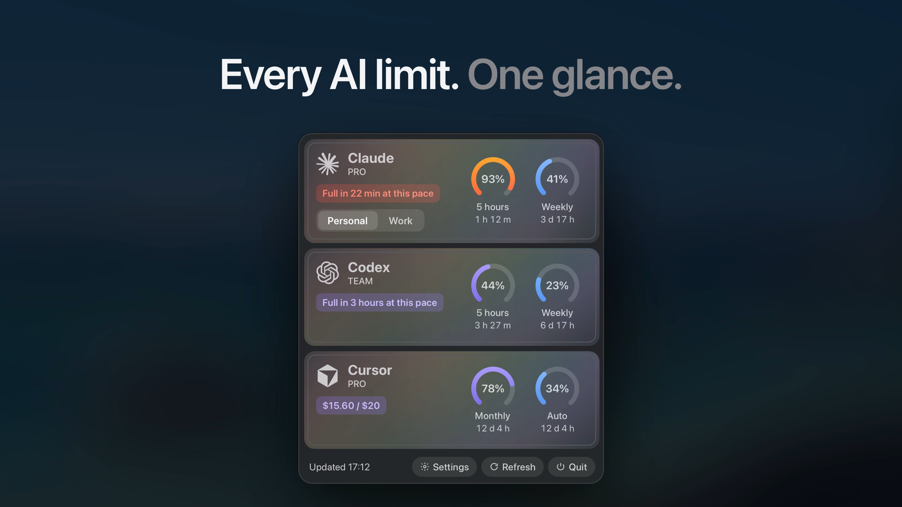

# AI Limit Tracker

Claude, Codex and Cursor limits in your Mac's menu bar.

I use all three at the same time and kept hitting limits out of nowhere, so I built this over a weekend.
There are similar apps, this is my take on it.

<p align="center"></p>

## Install

```bash
curl -fsSL https://raw.githubusercontent.com/bahadirnuroglu/ai_limit_tracker/main/install.sh | bash
```

Or get the dmg from [Releases](https://github.com/bahadirnuroglu/ai_limit_tracker/releases/latest). The app isn't notarized,
so macOS blocks it the first time. Allow it in System Settings → Privacy & Security → Open Anyway.
The Terminal line skips that step.

macOS 14 or later, Apple silicon and Intel. English and Turkish.

## What's in it

- 5-hour and weekly limits for each tool, and when you'll run out at your current pace
- Notifications at 75% and 90%, and when a limit resets
- Right-click a card to get pinged when a full limit opens again
- More than one account per tool, like work and personal
- Click a card for every limit and the last 13 weeks of activity
- <kbd>⌃</kbd><kbd>⌥</kbd><kbd>L</kbd> opens it from anywhere

## Privacy

You sign in once, in your own browser. Cursor is read from the Cursor app.
Tokens stay on your Mac, in a file only you can read. There's no server of mine in between,
the app only talks to Anthropic, OpenAI, Cursor and GitHub (for updates).

It reads undocumented endpoints, so it can break when they change. If something looks off,
Settings → General → Copy Diagnostics and open an issue. Not affiliated with Anthropic, OpenAI or Anysphere.

## Build

```bash
bash build-app.sh --install
```

Command Line Tools are enough. `bash build-dmg.sh` makes the dmg.

MIT license.

<details>
<summary>Türkçe</summary>

Claude, Codex ve Cursor limitleri Mac'in menü çubuğunda. Üçünü aynı anda kullanıyorum, habersizce limite takılıp
duruyordum, hafta sonu kendime yaptım.

Kurulum için yukarıdaki tek satır ya da [Releases](https://github.com/bahadirnuroglu/ai_limit_tracker/releases/latest)
sayfasındaki dmg. dmg ile kurarsan ilk açılışta Sistem Ayarları → Gizlilik ve Güvenlik → Yine de Aç.
macOS 14 ve üstü, Türkçe ve İngilizce.

</details>
