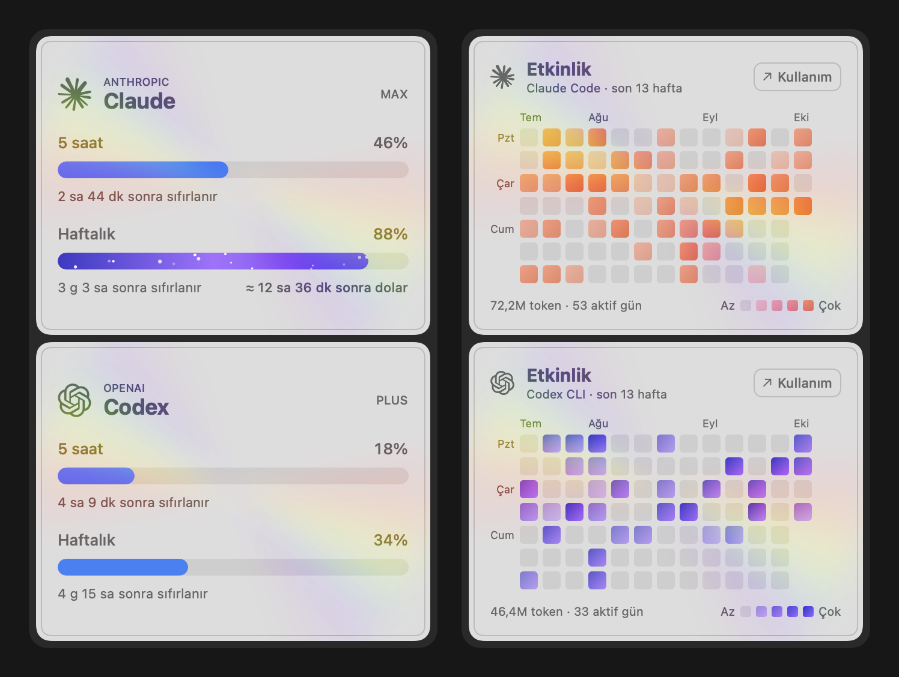

# AI Limit Tracker

Claude, Codex ve Cursor kullanım limitlerini macOS menü çubuğunda tek bakışta gösteren küçük bir uygulama.
Limite takılmadan önce haber verir, limit yenilenince "devam edebilirsin" der.

<p align="center"></p>

<sub>Görseldeki değerler örnektir.</sub>

## İndir

**[Son sürümü indir →](https://github.com/bahadirnuroglu/ai_limit_tracker/releases/latest)** (`AI-Limit-Tracker-x.y.z.dmg`)

1. dmg'yi aç, **AI Limit Tracker**'ı **Applications** klasörüne sürükle.
2. Applications'tan aç. "Apple doğrulayamadı" uyarısı çıkarsa **Bitti** de, sonra
   **Sistem Ayarları → Gizlilik ve Güvenlik → Yine de Aç**. Uygulama Apple Developer hesabıyla imzalı olmadığı
   için bu adım sadece ilk açılışta gerekir.
3. Kurulum asistanı açılır: kullandığın araçları seç, bağla, hangi bildirimleri alacağını belirle.

macOS 14 (Sonoma) ve üstü · Apple Silicon ve Intel. Yeni sürüm çıkınca popup'ta **Güncelle**'ye basman yeterli:
uygulama kendini indirip kurar ve yeniden açılır, "Yine de Aç" adımı tekrar gerekmez.

## Neler yapar

- **Üç sağlayıcı:** Claude, Codex, Cursor. Çoğu, bu Mac'te zaten açık olan oturumdan okunur;
  şifre gerekmez.
- **Halka kartlar:** Her sağlayıcı tek satır: 5 saatlik limit ve son kullandığın modelin limiti.
  %90'ı geçen limit her zaman öne çıkar; bu tempoyla sıfırlanmadan dolacaksa "≈ 12 sa sonra dolar",
  değilse haftalık limit için "Günlük bütçe ≈%9" yazar.
- **Kartın arka yüzü:** Karta tıkla, döner: tüm limitler ve GitHub tarzı 13 haftalık etkinlik haritası
  (Claude Code ve Codex CLI kayıtlarından).
- **Veri gelmezse:** Son veri soluk ve yaşıyla kalır; altında sebep ve tek düğmelik çözüm
  ("Cursor oturumunun süresi dolmuş · Cursor'u aç").
- **Bildirimler:** %75, %90 ve limit yenilenince; hangilerini alacağını sen seçersin.
- **Menü çubuğu:** 1–2 sağlayıcıda iç içe halkalar, daha fazlasında limite en yakın olanın halkası.
  <kbd>⌃</kbd><kbd>⌥</kbd><kbd>L</kbd> popup'ı her yerden açar.
- **macOS'a uyum:** Açık temada gümüş, koyu temada grafit kartlar; macOS 26'da Liquid Glass;
  Hareketi azalt, Saydamlığı azalt ve VoiceOver desteği. Mac açılınca kendiliğinden başlar.

## Veriler nereden geliyor

Her şey senin hesabınla ve senin Mac'inde; üçüncü bir sunucuya hiçbir şey gönderilmez.

| | Kaynak |
|---|---|
| Claude | Claude Code kuruluysa onun oturumu (`api.anthropic.com/api/oauth/usage`, macOS bir kez Anahtar Zinciri izni ister); yoksa uygulama içindeki claude.ai girişi. |
| Codex | Codex CLI'nin `~/.codex/auth.json` girişi → `chatgpt.com/backend-api/wham/usage`. |
| Cursor | Cursor uygulamasının kendi oturumu (salt okunur) → `cursor.com/api/usage-summary`. |
| Etkinlik haritası | Bu Mac'teki Claude Code (`~/.claude/projects`) ve Codex CLI (`~/.codex/sessions`) kayıtları. |

Sorun yaşarsan **Ayarlar → Genel → Tanılama Bilgisini Kopyala** ile durumu paylaşabilirsin; token ya da hesap
bilgisi içermez.

> Resmi bir uygulama değildir; Anthropic, OpenAI ya da Anysphere ile bağlantısı yoktur. Kullanılan
> adresler belgesizdir ve değişebilir; değişirse kartta ipucu çıkar ve uygulamanın güncellenmesi gerekir.

## Kaynaktan derleme

Xcode Command Line Tools yeterli (Xcode projesi yok, SwiftPM kullanılmıyor):

```bash
bash build-app.sh --install   # derler, ad-hoc imzalar, /Applications'a kurar ve açar
bash build-dmg.sh             # dist/AI-Limit-Tracker-<sürüm>.dmg (Finder'a simge yerleşimi yaptırır)
```

Uygulama ikonu `tools/make-icon.swift` ile çizilir: `bash tools/make-icon.sh`.

### Yeni sürüm yayınlama

1. `Info.plist` içinde `CFBundleShortVersionString` ve `CFBundleVersion`'ı artır, commit'le.
2. `bash release.sh`: `main`'i gönderir, dmg'yi derler, `v<sürüm>` etiketiyle GitHub sürümü açar ve dmg'yi ekler.
   Token Anahtar Zinciri'nde `ailimit-github` adıyla durur (sadece bu depo, Contents: Read and write).

---

<details>
<summary><b>English</b></summary>

AI Limit Tracker is a macOS menu bar app that shows your Claude, Codex and Cursor usage limits at a
glance, warns you at 75% / 90% (you choose which), estimates when a limit will run out at your current pace, notifies
you when it resets, and flips each card to all limits plus a GitHub-style 13-week activity heatmap built from local
Claude Code / Codex CLI logs. Most providers are read from sessions already on your Mac, no password needed.

Download the latest `.dmg` from [Releases](https://github.com/bahadirnuroglu/ai_limit_tracker/releases/latest),
drag the app to Applications, then allow it once in System Settings → Privacy & Security → Open Anyway
(the app is ad-hoc signed). Requires macOS 14+. Unofficial; not affiliated with Anthropic, OpenAI or Anysphere.

</details>
